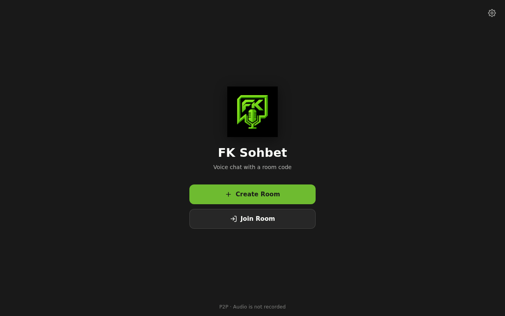
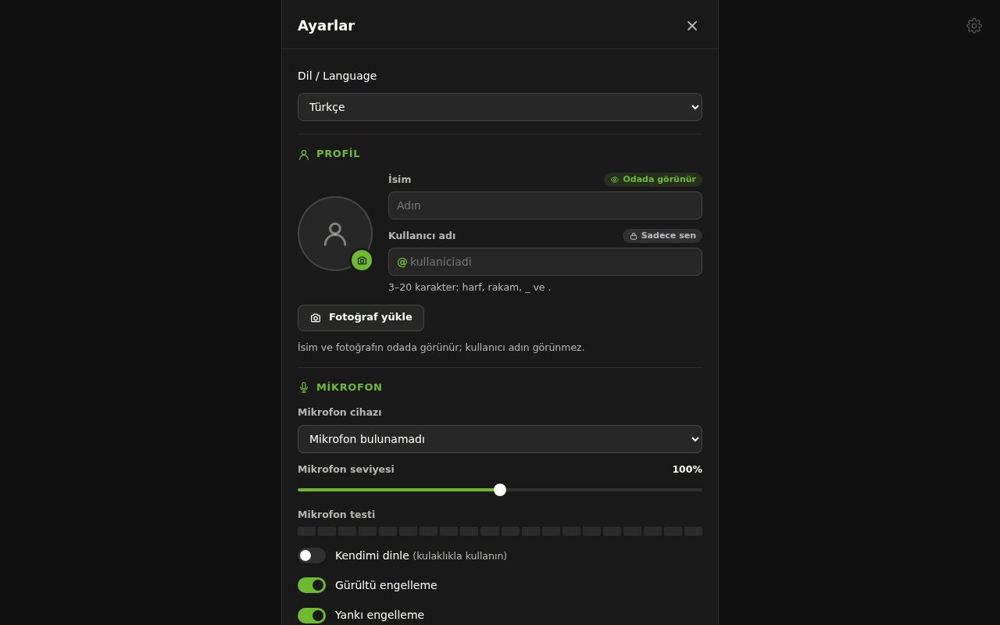
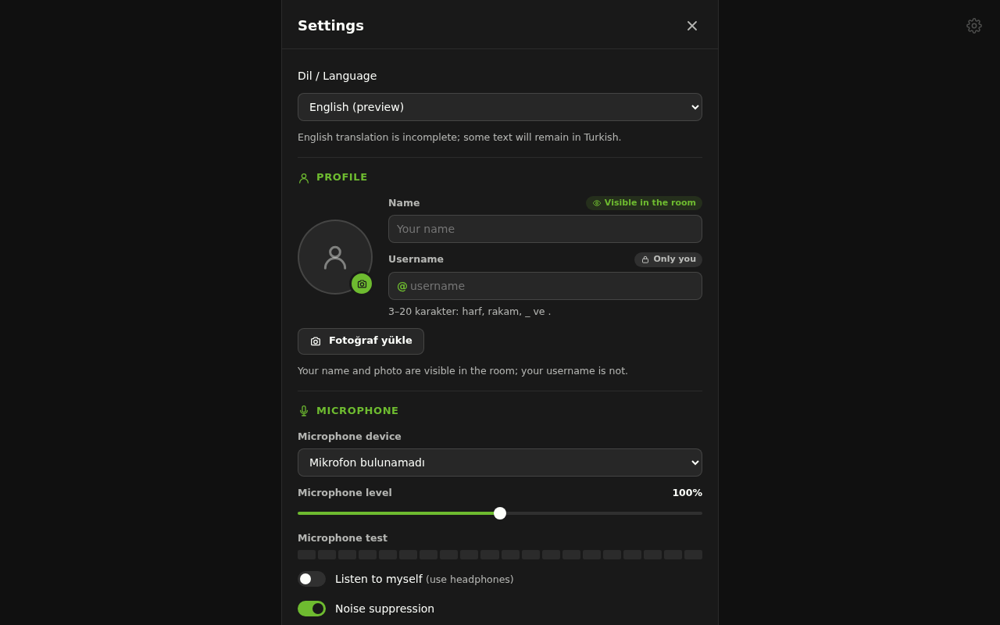

# FK Chat / FK Sohbet — 1.0.2-recovery.1

> **Not a production release.** This is an incomplete recovery of FK Sohbet from decompiled Android and Windows archives, with an experimental English preview. Do not publish, distribute as a finished product, or rely on it for real conversations. Android and Windows runtime behavior has not been verified. The original source projects, if available, are preferable.

## Project Overview

FK Sohbet is a peer-to-peer communication application using a shared HTML/CSS/JavaScript interface embedded in Android WebView and Windows WebView2. This repository-style working tree was recovered from user-supplied archives, not from the original development repositories. The Android Gradle project and portions of decompiled native code have been reconstructed. The Windows C# source has also required a decompiler repair.

## Features

The recovered code contains room-code connection, peer-to-peer audio and chat, file exchange, profile settings, and Windows-specific overlay and remote-control code. **These are code observations, not claims that the recovered builds work.** No end-to-end feature verification has been performed.

## Language Support

Turkish remains the default. Settings contains an experimental Turkish/English selector for selected web-interface text and connection notifications. A browser `localStorage` preference is used to remember the selection. Other dynamic messages, error strings and native Android/Windows UI are **not** comprehensively translated. Some existing runtime code can replace translated text. Do not represent the application as fully bilingual.

The preview deliberately does not translate user chat content. `tests/` checks selected static labels, localStorage behavior, and basic web-script startup in jsdom; it does not test native applications or conversations.

## Screenshots

The images below show the recovered web interface rendered in a desktop browser. They are **not** screenshots of an installed Android or Windows build, and do not verify calls or other native features. English is still a partial preview.

### Home screen — Turkish


### Home screen — English preview



### Settings — Turkish



### Settings — English preview



## Android Installation

Build an APK locally using the instructions below; no APK is tracked or published. A debug APK is for development investigation only, **not** a release. Its signing certificate differs from the supplied original APK, so it cannot update an installed copy signed with the original certificate. Removing the old app to install a test build can delete local application data; back it up first. Android installation and runtime have not been tested.

## Windows Installation

Build the application locally using the instructions below; no built executable is published. This is a .NET Framework application, not a self-contained executable. Windows with .NET Framework 4.8 and Microsoft Edge WebView2 Runtime are required. Build success on Linux does not establish that the program runs on Windows. No Windows installation or runtime verification has been performed.

## Build Instructions

### Android debug build

Requirements: JDK 17, Android SDK platform 34 and build-tools 34.0.0, network access to Gradle and Maven repositories. Set `ANDROID_HOME` or create an Android Studio `local.properties` pointing to your SDK. From the `android/` directory:

```sh
./gradlew assembleDebug
```

On Windows use `gradlew.bat assembleDebug`. Output: `app/build/outputs/apk/debug/app-debug.apk`. This is signed with the local Android debug key. A release requires a separately secured signing configuration and a verified signing identity; none is included here.

### Windows build

Requirements: .NET SDK 10 (C# 14), .NET Framework 4.8 reference assemblies (restored by NuGet), and the WebView2 managed/native binaries already present in `windows/`. In `windows/`:

```sh
dotnet build FK-Sohbet.csproj -c Release -p:EnableWindowsTargeting=true
```

The earlier handoff cross-build produced `windows/bin/Release/net48/FK Sohbet.exe`. The generated `.exe.config` and dependency files should accompany it. A successful compilation does not substitute for a Windows runtime test. The executable is not self-contained and needs .NET Framework 4.8 and WebView2 Runtime.

### Web preview tests

With Node.js 22 and npm:

```sh
npm ci
npm test
```

These tests use jsdom, not Android WebView or WebView2. They do not test connectivity, audio, native permissions, overlay, file transfer or remote control.

## Requirements and Dependencies

- Android: min SDK 24, target SDK 34 in the recovered manifest; microphone/network/foreground-service and other permissions. Android API-level behavior remains untested.
- Windows: .NET Framework 4.8, Windows Forms, WebView2 Runtime; bundled WebView2 interop/loader files.
- JavaScript: PeerJS vendored in the respective web assets; its own license is included with those assets.
- Services: PeerJS signaling and STUN are configured in the recovered JavaScript; custom TURN and Giphy are optional user-entered settings. Their availability and interoperability were not tested.

## Configuration

The current application reads settings from the UI and stores them in WebView localStorage. `config.example.json` is an **illustrative inventory only** and is not loaded by the application. TURN configuration and a Giphy API key can be entered in settings. No service credentials are supplied.

## API Keys and Security

Do not commit signing keys, passwords, access tokens, user data or `.env` files. `.gitignore` is a precaution, not a security audit. The recovered implementation stores Giphy and TURN credentials in localStorage without demonstrated OS-backed encryption; anyone with access to the application profile may be able to read them. Client-side keys cannot be treated as server secrets. Review service key restrictions, permission requests, WebView bridges, untrusted peer messages and remote control before public use. The supplied artifacts were not security audited.

The Android debug certificate is intentionally different from the original certificate. Do not commit or publish private keystores. Signing must be handled separately and securely.

## Project Structure

```text
android/       Reconstructed Android Gradle project and web assets
windows/       Recovered Windows project, WebView2 assets and embedded web files
tests/         jsdom smoke and experimental language tests
Images/        Browser screenshots used by this README
docs/          Recovery and test notes
artifacts/     Optional local untested builds; ignored by Git
```

The web assets are duplicated across platform folders and should be consolidated carefully after the original project structure is known. Third-party files retain their own notices.

## Version History

See `CHANGELOG.md`. `1.0.2-recovery.1` is a development version, not a Git tag or a published release. Android uses version code `4`; Windows reports file version `1.0.2.1`.

## License

The repository already contains a [MIT license](LICENSE). The recovery archives did not include a project license; confirm that the existing license applies to the imported code and that all assets and binaries may be redistributed before publishing them. Do not publicly distribute the code without confirming rights. PeerJS has a separate license included in the vendor assets; other dependencies require independent review.

## Downloads and Releases

The project repository is [FurkanDev07/FK-Chat](https://github.com/FurkanDev07/FK-Chat). There is no verified GitHub Release or download for this version. See the [release checklist](docs/RELEASE-CHECKLIST.md) before distributing Android or Windows binaries.
